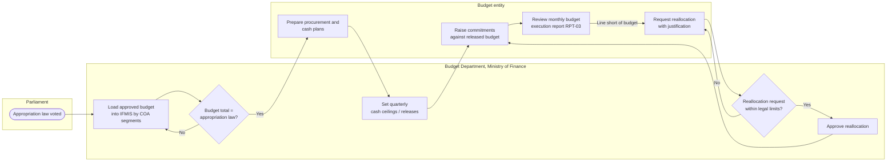

# Budget Execution Process

*Author: Anicet Safari, CPA · Illustrative work sample, October 2026*

## Process map

## Steps

| # | Step | Actor | System event | Control |
|---|---|---|---|---|
| 1 | Load the voted budget at the agreed segment level | Budget Department | Budget journal (original) posted to budget ledger | `C-01` Budget load reconciled to the appropriation law; approved by a second officer |
| 2 | Entity prepares procurement and cash plans | Budget entity | Plans attached to entity profile | — |
| 3 | Set quarterly releases (cash ceilings) | Budget Department | Release journal; commitments limited to released amounts | `C-02` Releases cannot exceed the appropriation per line |
| 4 | Raise commitments | Budget entity | Commitment reduces available budget | `C-04` Funds availability check (hard stop) |
| 5 | Monitor execution | Budget entity | RPT-03 monthly | `C-03` Monthly review of RPT-03 signed off by the accounting officer |
| 6 | Request and approve reallocation | Entity → Budget Department | Reallocation journal with approval trail | `C-05` Reallocations within legal limits; two-level approval; reason code required |

## Business rules

- **BR-01** The budget is loaded at the same segment level used for posting (fund, unit, economic sub-group, programme), so the funds-availability check runs on like-for-like codes.
- **BR-02** Available budget = released budget − commitments outstanding − payments.
- **BR-03** A reallocation keeps the total appropriation for the entity unchanged; moves across programmes need higher approval than moves within a programme.

## Improvement opportunities typically found

| Issue | Effect | Improvement |
|---|---|---|
| Budget loaded at a higher level than postings | Funds check cannot work at line level | Align budget and posting levels (BR-01) |
| Reallocations approved outside the system | Final budget in reports does not match approvals | Route all reallocations through the system workflow |
| Execution report only at year-end | Late discovery of under-spending | Monthly RPT-03 with exception section |
