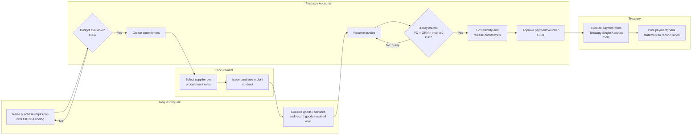

# Commitment-to-Payment (Expenditure) Process

*Author: Anicet Safari, CPA · Illustrative work sample, October 2026*

## Process map

## Steps

| # | Step | Actor | System event | Control |
|---|---|---|---|---|
| 1 | Raise requisition with full COA code | Requesting unit | Requisition record | `C-06` Combination validation rules (folder 01) |
| 2 | Check funds availability and create commitment | Finance | Commitment reduces available budget | `C-04` Hard stop if available budget is insufficient |
| 3 | Procure and issue PO / contract | Procurement | PO linked to commitment | Segregation: requester ≠ procurement officer |
| 4 | Receive goods / services | Requesting unit | Goods received note (GRN) | Receiver ≠ person who raised the PO |
| 5 | Receive and match invoice | Finance | Invoice matched to PO and GRN | `C-07` Three-way match with tolerance; mismatch blocks payment |
| 6 | Post liability; release commitment | Finance | Dr expense / Cr payables; commitment closed | Automatic; no manual liability posting allowed |
| 7 | Approve payment voucher | Authorised officer | Voucher approved | `C-08` Approval limits by amount; preparer ≠ approver |
| 8 | Pay | Treasury | Dr payables / Cr TSA | `C-09` Payee bank details from verified supplier master only |
| 9 | Reconcile | Treasury / Accounts | Bank statement imported | `C-10` Monthly bank reconciliation (folder 07) |

## Key data objects

Requisition → Commitment → Purchase order → Goods received note → Invoice → Payment voucher → Payment → Bank statement line. Each object carries the reference of the one before it, so any payment can be traced back to the budget line it consumed.

## Exceptions handled

| Exception | Handling |
|---|---|
| Invoice exceeds PO by more than tolerance | Blocked; requires PO amendment and a new funds check |
| Partial delivery | Partial GRN; invoice matched to quantity received; commitment stays open for the balance |
| Supplier bank details changed | Change only through supplier master workflow with independent verification (`C-09`) |
| Year-end open commitments | Listed for review; carried forward or cancelled per fiscal rules |
