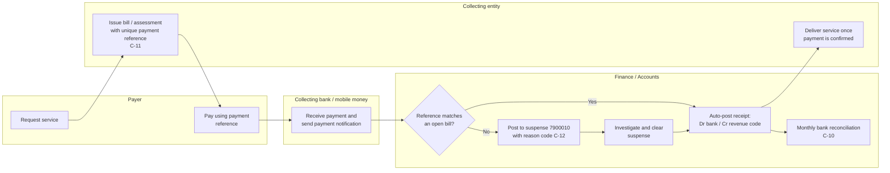

# Revenue Receipting Process (Non-Tax Revenue)

*Author: Anicet Safari, CPA · Illustrative work sample, October 2026*

Scope: fees and charges collected by a government entity (for example administrative fees), paid by bank transfer or mobile money into a collection account and swept to the Treasury Single Account.

## Process map

## Steps

| # | Step | Actor | System event | Control |
|---|---|---|---|---|
| 1 | Issue bill with unique payment reference | Collecting entity | Receivable / bill record coded to the revenue item | `C-11` References are system-generated and unique |
| 2 | Payer pays | Payer / bank | Payment notification | — |
| 3 | Match payment to bill | Finance (automatic) | Receipt posted, bill closed | Automatic match on reference and amount |
| 4 | Unmatched receipts to suspense | Finance | Suspense posting with reason code | `C-12` Suspense items aged and cleared within 30 days |
| 5 | Deliver service | Collecting entity | Service status updated | Service only after payment is confirmed |
| 6 | Reconcile collection account | Finance | Reconciliation record | `C-10` Monthly reconciliation; differences explained |

## Business rules

- **BR-11** A receipt is recognised when the bank confirms the payment, not when the bill is issued (cash basis).
- **BR-12** Revenue is classified by the economic code on the bill, so classification is decided once, at billing.
- **BR-13** Over-payments are posted to a payer credit balance, not to revenue.
