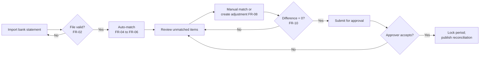

# Functional Specification — Bank Reconciliation Module

*Author: Anicet Safari, CPA · Illustrative work sample, October 2026*

| Item | Value |
|---|---|
| Document | Functional Specification Document (FSD) |
| Module | Cash Management — Bank Reconciliation |
| Version | 1.0 (sample) |
| Related | Process maps (folder 03), controls `C-10`, `C-12` (folder 06), user stories BR-US-01 to BR-US-08 (folder 05), procedure (folder 07) |

## 1. Purpose and scope

The module reconciles each government bank account (Treasury Single Account sub-accounts, project accounts and revenue collection accounts) with its cash book in the IFMIS. It imports bank statements, matches statement lines to cash book entries automatically, routes unmatched items to users for resolution, and produces a signed-off reconciliation statement each month.

**In scope:** statement import, automatic and manual matching, exception handling, reconciliation statement, approval workflow, reports.
**Out of scope:** payment execution, bank account opening and closure, foreign-exchange revaluation (separate specification).

## 2. Actors and roles

| Role | Responsibilities | Segregation rule |
|---|---|---|
| Reconciliation Officer | Imports statements, reviews matches, resolves exceptions, prepares the reconciliation | Cannot approve own reconciliation; cannot post payments |
| Reconciliation Approver (Chief Accountant) | Reviews and approves the reconciliation | Cannot edit matches |
| System Administrator | Maintains matching rules and tolerances | Changes logged; no access to approve |
| Auditor (read-only) | Views reconciliations and audit trail | Read-only |

## 3. Process overview

## 4. Functional requirements

### 4.1 Statement import

| ID | Requirement | Priority |
|---|---|---|
| FR-01 | The system shall import bank statements in the bank's electronic format (e.g. MT940 or agreed CSV layout) and allow manual upload where no electronic feed exists. | Must |
| FR-02 | The system shall reject a statement file if (a) the account number does not match a registered account, (b) the opening balance differs from the previous statement's closing balance, or (c) the statement period overlaps an imported period. It shall show the reason. | Must |
| FR-03 | Each imported line shall keep: value date, booking date, amount, debit/credit sign, bank reference, narrative, and payer/payee where provided. | Must |

### 4.2 Automatic matching

| ID | Requirement | Priority |
|---|---|---|
| FR-04 | **Rule 1 — exact reference:** match one statement line to one cash book entry where the payment / receipt reference and the amount are equal. | Must |
| FR-05 | **Rule 2 — amount and date window:** where Rule 1 fails, match where the amount is equal and the dates are within a configurable window (default ±3 working days), provided only one candidate exists. | Must |
| FR-06 | **Rule 3 — one-to-many:** match one statement line to several cash book entries (e.g. a bulk payment file) where the sum of entries with the same batch reference equals the line amount. | Should |
| FR-07 | Rules run in order 1 → 3. An item matched by one rule is not considered by the next. Each match records the rule that produced it. | Must |

### 4.3 Exceptions and adjustments

| ID | Requirement | Priority |
|---|---|---|
| FR-08 | The officer shall be able to (a) match items manually, (b) record bank charges or interest found on the statement as cash book adjustments with the correct economic code, and (c) flag timing differences (unpresented payments, uncredited receipts). | Must |
| FR-09 | Unidentified receipts on the statement shall be posted to suspense (`7900010`) with a reason code, and appear on the suspense ageing report. | Must |

### 4.4 Reconciliation statement and approval

| ID | Requirement | Priority |
|---|---|---|
| FR-10 | The system shall calculate: balance per bank statement + uncredited receipts − unpresented payments ± other reconciling items = balance per cash book. Submission is blocked unless the unexplained difference is zero. | Must |
| FR-11 | Submission routes the reconciliation to the approver. The approver can approve or return it with a comment. | Must |
| FR-12 | Approval locks the period for that account: no further matching or cash book back-dating is possible without a logged re-opening by the approver. | Must |
| FR-13 | Reconciliations shall be due by working day 10 of the following month; overdue reconciliations appear on a dashboard by entity. | Should |

### 4.5 Reports

| ID | Report | Content |
|---|---|---|
| FR-14 | Reconciliation statement | The FR-10 statement with list of reconciling items, preparer and approver, dates. |
| FR-15 | Unmatched items ageing | Unmatched statement and cash book items by age band (0–30, 31–60, 61–90, > 90 days). |
| FR-16 | Reconciliation status dashboard | All accounts: last reconciled period, status, days overdue. |

## 5. Business rules and data validations

| ID | Rule |
|---|---|
| BRL-01 | A cash book entry can be matched to at most one statement line, except under FR-06. |
| BRL-02 | Tolerance for automatic matching is zero on amount. Date windows are configurable per account type. |
| BRL-03 | Reconciling items older than 90 days require a written explanation on the reconciliation. |
| BRL-04 | Changes to matching rules and tolerances require approval and are logged with old and new values. |

## 6. Non-functional requirements

| ID | Requirement |
|---|---|
| NFR-01 | Auto-matching of a 10,000-line monthly statement completes in under 5 minutes. |
| NFR-02 | Full audit trail: who imported, matched, unmatched, adjusted, submitted and approved, with timestamps. |
| NFR-03 | Role-based access as in section 2, enforced by the system. |

## 7. Acceptance

Each requirement is covered by at least one user story with acceptance criteria in folder 05; the traceability matrix there shows the link from requirement to story to test case.

## 8. Open questions (for confirmation with process owners)

1. Which banks provide electronic statements, and in which format?
2. Should bulk salary payments be matched by batch (FR-06) or by individual transaction?
3. Who may re-open a locked period, and is a second approval needed?
